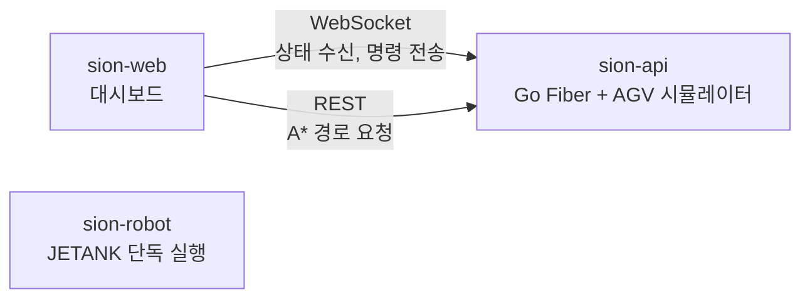

# Sion Web

> AGV 관제 대시보드

React 19 · TypeScript · Vite 7 · 데모 https://sion.tolelom.xyz

## 개요

Sion은 LoL 챔피언 사이온의 궁극기(목표를 향한 직선 돌진)를 Jetson 기반 AGV로 옮긴 프로젝트다. AGV는 맵에서 적을 찾아 장애물을 피해 접근한 뒤 직선 구간에서 가속해 돌진한다.

이 저장소는 그 AGV를 브라우저에서 보고 조작하는 대시보드다. 맵에 AGV 위치와 경로, 적, 장애물을 그리고, 모드 전환과 긴급 정지, 목표 지정 명령을 보낸다.

Sion은 데모 전용으로 동작한다. 대시보드는 [sion-api](https://github.com/tolelom/sion-api)에 붙고, sion-api 안의 시뮬레이터가 AGV 역할을 한다. 모든 방문자가 시뮬레이터 하나를 같이 조작한다. 실제 로봇([sion-robot](https://github.com/tolelom/sion-robot))은 JETANK에서 단독으로 돌며 서버와 연결되지 않는다.

## 시스템 구성



| 저장소 | 역할 |
|---|---|
| sion-web | 관제 대시보드(이 저장소) |
| [sion-api](https://github.com/tolelom/sion-api) | 대시보드용 WebSocket·REST 서버. 내장 시뮬레이터가 AGV 역할을 한다 |
| [sion-robot](https://github.com/tolelom/sion-robot) | JETANK 제어. 경로 계획, 경로 추종, 적 돌진. 서버와 연결되지 않는다 |

## 기능

- 20x20 맵에 AGV 위치, 장애물, 목표(적), 이동 경로 표시
- 맵 클릭으로 목표 지정: 서버에서 A* 경로를 받아 이동 명령 전송
- 자동/수동 모드 전환, 긴급 정지, 초기화
- 배터리, 속도, 상태 표시
- WebSocket 연결 상태 표시와 자동 재연결(최대 10회)

## 구조

| 경로 | 책임 |
|---|---|
| `src/components/Dashboard` | 화면 배치, 서버 연결 표시 |
| `src/components/Map` | Canvas 맵 렌더링. `mapGeometry`(좌표 변환), `mapDrawing`(요소별 그리기), `mapLayers`(레이어 합성) |
| `src/components/Controls` | 모드 전환, 긴급 정지, 초기화 버튼 |
| `src/components/Status` | 배터리, 속도, 상태 표시 |
| `src/hooks/useWebSocket.ts` | 연결, 재연결, 명령 전송 |
| `src/hooks/messageRouter.ts` | 수신 메시지(position, status, map_update, system_info, error)를 상태 훅으로 분배 |
| `src/hooks/usePathfinding.ts` | `POST /api/pathfinding` 호출(새 요청이 이전 요청을 취소) |
| `src/hooks/useMoveCommand.ts` | 맵 클릭을 경로 요청과 이동 명령으로 연결 |
| `src/types` | AGV, 맵, 수신 메시지(`messages.ts`), 송신 명령(`commands.ts`) 타입 |
| `src/config.ts` | 빌드 시점 환경변수(`VITE_WS_URL`, `VITE_API_BASE_URL`, `VITE_API_TIMEOUT`) |

## 실행

Node.js와 로컬 [sion-api](https://github.com/tolelom/sion-api)가 필요하다.

```bash
git clone https://github.com/tolelom/sion-web.git
cd sion-web

npm install
cp .env.example .env.local
npm run dev
```

`.env.example`은 로컬 sion-api(`localhost:8001`)를 가리킨다.

| 명령 | 용도 |
|---|---|
| `npm run dev` | 개발 서버 |
| `npm run test` | Vitest 테스트 |
| `npm run lint` | ESLint |
| `npm run typecheck` | `tsc --noEmit` 타입 검사 |
| `npm run build` | 타입 검사 후 프로덕션 빌드 |
