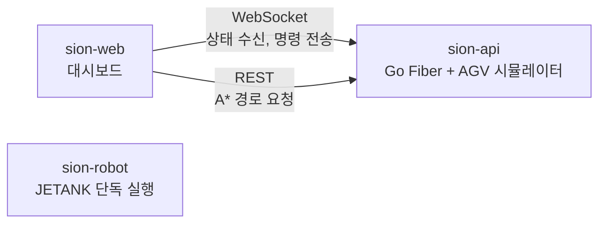

# Sion Web

> AGV 관제 대시보드

React 19 · TypeScript · Vite 8 · 데모 https://sion.tolelom.xyz



Sion은 LoL 챔피언 사이온의 궁극기(목표를 향한 직선 돌진)를 Jetson 기반 AGV로 옮긴 프로젝트입니다. AGV는 맵에서 적을 찾아 장애물을 피해 접근한 뒤 직선 구간에서 가속해 돌진합니다. 데모에서는 [sion-api](https://github.com/tolelom/sion-api) 안의 시뮬레이터가 AGV 역할을 하고, 실제 로봇 코드인 [sion-robot](https://github.com/tolelom/sion-robot)은 JETANK에서 단독으로 돌며 서버와 연결되지 않습니다.

## 기능

- 맵에 AGV 위치, 장애물, 목표(적), 이동 경로 표시
- 맵 클릭으로 목표 지정: 서버에서 경로를 받아 이동 명령 전송
- 자동/수동 모드 전환, 긴급 정지, 초기화
- 배터리, 속도, 상태 표시
- 모든 방문자가 AGV 하나를 같이 조작
- 서버 연결 상태 표시와 자동 재연결

## 시작하기

Node.js 22와 로컬 [sion-api](https://github.com/tolelom/sion-api)가 필요합니다.

```bash
git clone https://github.com/tolelom/sion-web.git
cd sion-web
npm install
npm run dev
```

| 접속 | 주소 |
|---|---|
| 대시보드 | http://localhost:5173 |

개발 서버는 `.env.development`에 적힌 로컬 sion-api 주소(`localhost:8001`)에 붙습니다. 주소를 바꾸려면 `.env.example`을 `.env.development.local`로 복사해 고칩니다.

## 문서

| 문서 | 내용 |
|---|---|
| `ARCHITECTURE.md` | 저장소 역할과 코드 지도 |

## 기여

개발 명령, 계약 갱신 절차, 배포 흐름은 `CONTRIBUTING.md`에 있습니다.
